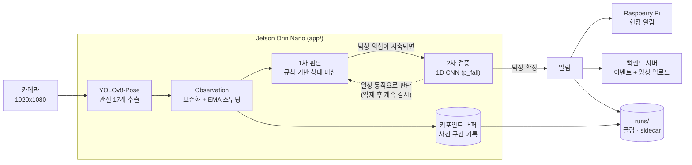
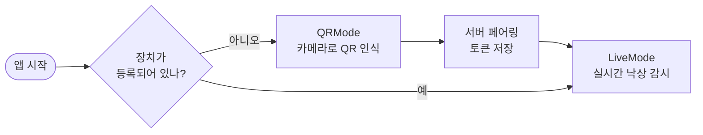
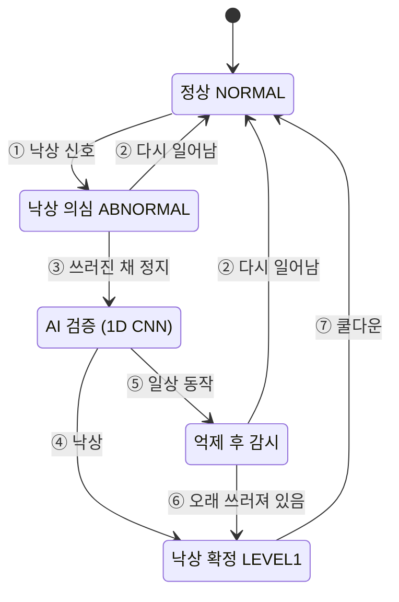
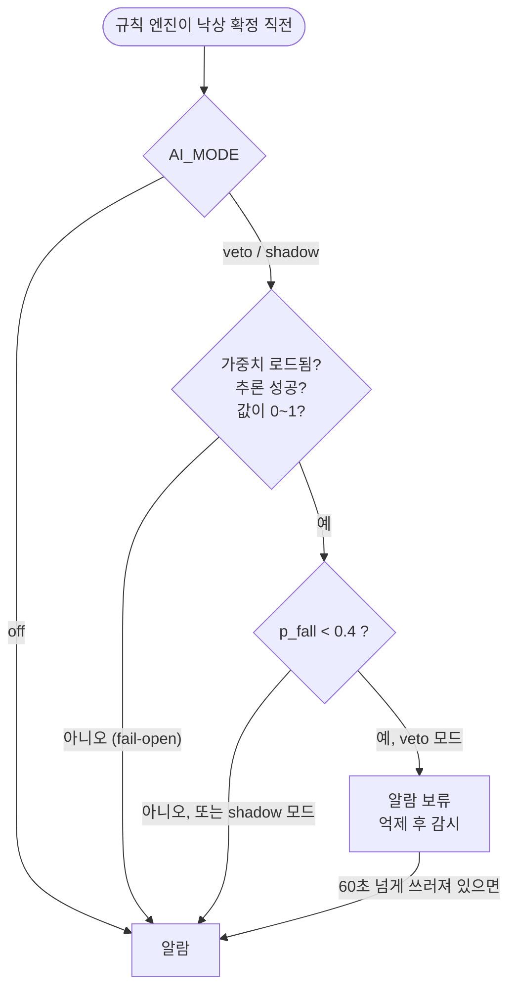
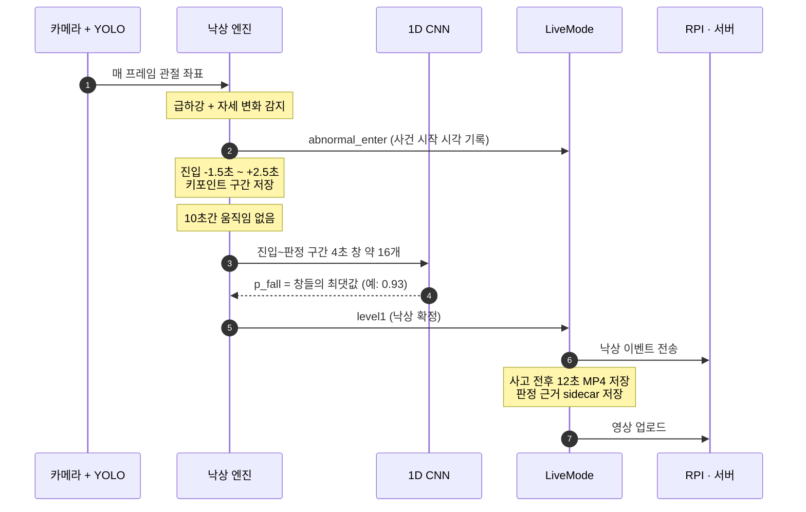
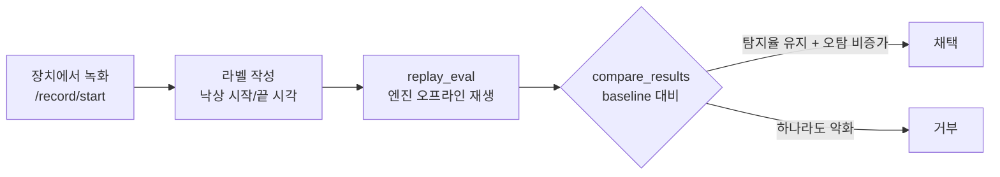

# Fall Detection Edge App

**Jetson Orin Nano 위에서 카메라 한 대로 사람의 낙상을 실시간 감지하는 엣지 애플리케이션**


YOLOv8-Pose로 사람의 관절 좌표를 뽑고, **규칙 기반 상태 머신이 빠르게 낙상을 의심**한 뒤
**1D CNN이 키포인트 시계열을 보고 한 번 더 검증**합니다. 확정되면 보호자 장치(Raspberry Pi)와 서버에 알리고 사고 전후 영상을 업로드합니다.

> 목표: 실제 낙상은 놓치지 않으면서(높은 recall), 침대에 눕기·빨리 앉기 같은 일상 동작의 오탐은 줄이기

---

## 한눈에 보기



| 단계 | 하는 일 | 위치 |
| --- | --- | --- |
| 자세 추출 | YOLOv8-Pose로 가장 확실한 1명의 관절 17개 좌표 추출, 대상 전환 감지 | `app/engine/` |
| 1차 판단 | 하강 속도·자세 비율·어깨 하강·높이 붕괴를 조합해 낙상 의심 → 확정 | `app/core/level1.py` |
| 2차 검증 | 낙상 진입부터 판정까지 4초 창(약 16개)을 1D CNN에 넣어 가장 높은 낙상 확률 `p_fall` 사용 | `app/ai_classifier/` |
| 알림·기록 | RPI/서버 이벤트, 사고 전후 MP4 업로드, 판정 근거(sidecar) 저장 | `app/modes/live_mode.py` |

## 동작 방식

### 1. 장치 시작: QR 페어링 → 실시간 감시

앱은 시작할 때 장치 등록 상태를 보고 모드를 고릅니다. QR로 등록을 마치면 재시작 없이 감시 모드로 넘어갑니다.



### 2. 낙상 판단 상태 머신

한 프레임만 보고 판단하지 않습니다. **의심 → 지속 확인 → AI 검증 → 확정** 순서로 상태가 바뀝니다.



| 전이 | 조건 (기본값) |
| --- | --- |
| ① 낙상 신호 | 아래 신호 중 2개 이상이 0.35초 지속, 또는 누운 자세가 45프레임 지속 |
| ② 다시 일어남 | 서 있는 자세로 2초 회복 |
| ③ 쓰러진 채 정지 | 10초간 움직임 없음, 또는 10초 경과 + 자세 붕괴 확인 |
| ④ 낙상 | AI의 낙상 확률 `p_fall > 0.4`, 또는 AI가 판단할 수 없음 (fail-open) |
| ⑤ 일상 동작 | `p_fall ≤ 0.4` → 알람을 보류하고 계속 감시 |
| ⑥ 오래 쓰러져 있음 | 보류 후 60초 넘게 쓰러져 있고, 진입 시 급하강이 있었음 → AI와 무관하게 알람 |
| ⑦ 쿨다운 | 알람 후 25초 |

판단에 쓰는 신호:

- **하강 속도**: 사람 박스 중심이 빠르게 내려감
- **자세 비율**: 세로로 길던 박스가 가로로 눕는 형태로 바뀜
- **어깨 하강**: 어깨 관절이 빠르게 내려감
- **높이 붕괴**: 박스 높이가 평소보다 크게 줄어듦
- **정지 지속**: 쓰러진 뒤 움직임이 거의 없음

### 3. AI 2차 검증은 알람을 "조용히" 지우지 못하게 설계

딥러닝 모델이 틀려도 실제 낙상 알람이 사라지지 않도록, 판단이 불확실하면 항상 규칙 기반 결과(알람)를 따릅니다.



- `veto`: AI가 일상 동작이라고 하면 알람을 보류 (기본값)
- `shadow`: AI 판단은 기록만 하고 알람은 규칙대로 (현장 검증용)
- `off`: AI를 쓰지 않음

### 4. 낙상 한 건이 처리되는 과정



## 빠른 시작

### Docker Compose (Jetson)

```bash
cp .env.example .env          # 서버/RPI 없이 실행하려면 ENABLE_* 값을 0으로
docker compose up -d --build
curl http://localhost:8000/health
```

기본 설정: 컨테이너 `jetson-edge`, 포트 `8000`, 카메라 `/dev/video0`, `runs/` 호스트 마운트, NVIDIA 런타임.
PyTorch/CUDA는 베이스 이미지(`dustynv/pytorch`)가 제공합니다.

### 로컬 실행

```bash
python -m venv .venv && source .venv/bin/activate
pip install -r requirements.txt   # + 환경에 맞는 torch
uvicorn app.main:app --host 0.0.0.0 --port 8000
```

### 주요 API

| Method | Endpoint | 설명 |
| --- | --- | --- |
| GET | `/health` | 앱 상태 (모드, 등록 여부, AI 분류기 상태, 처리 FPS) |
| GET | `/level1/status` | 최근 낙상 이벤트, 클립 레코더 상태 |
| GET | `/pose` | 가장 최근 Observation |
| GET | `/api/iot/device/falls/stream_overlay` | 분석 오버레이 MJPEG 스트림 |
| GET | `/api/iot/device/falls/stream` | 원본 MJPEG 스트림 |
| POST | `/record/start`, `/record/stop` | Observation JSONL 녹화 (오프라인 평가용) |
| POST | `/replay/start?path=...&fps=15`, `/replay/stop` | 녹화본 리플레이 |

설정은 모두 환경변수로 바꿀 수 있습니다. 전체 목록은 [`.env.example`](.env.example), 튜닝 방법은 [TUNING_GUIDE](docs/TUNING_GUIDE.md)를 보세요.

## 실험 결과

공개 데이터 5종의 평가 클립 712개(낙상 472, ADL 240)로 비교했습니다. 사건 단위 5-fold로 나눠 같은 사건이
학습과 평가에 함께 들어가지 않게 했고, Jetson과 같은 15Hz 상태 머신으로 재생해 클립 단위로 셌습니다.

| 단계 | 바꾼 것 | 낙상 탐지율 | ADL 오탐률 | Balanced |
| --- | --- | --- | --- | --- |
| A | 규칙만 | 0.608 | 0.323 | 0.635 |
| B | + 1D CNN, URFD만 학습 (원래 방식) | 0.291 | 0.099 | 0.434 |
| C | + 학습 데이터 추가 (6개 데이터셋) | 0.583 | 0.174 | 0.682 |
| D | + 학습 창을 운영 입력과 맞춤 | 0.517 | 0.075 | 0.662 |
| E0 | + 낙상 순간(ABNORMAL 진입 구간) 특징, 고전 ML | 0.543 | 0.061 | 0.686 |
| E0max | + 진입 이후 창들의 최대 확률로 판정 (재학습 없음) | 0.595 | 0.112 | 0.711 |

탐지율과 오탐률은 5개 fold 평균, Balanced는 탐지율과 (1 - 오탐률)의 조화평균입니다.

- **원래 방식은 규칙만보다 나빴습니다.** 1D CNN이 규칙이 잡은 실제 낙상의 절반 이상을 지웠습니다.
- **가장 큰 개선은 데이터였습니다.** 모델을 그대로 두고 데이터만 늘린 C가 B보다 balanced +0.248입니다.
- **판정 창 선택이 모델 종류보다 중요했습니다.** 고전 ML, CNN, TCN의 차이는 fold 편차 안이었습니다.
  같은 모델이라도 진입 이후 창들의 최댓값으로 판정하면(E\*) 세 모델 모두 좋아졌습니다.
- **정상 데이터만으로도 꽤 갑니다.** 정상 행동 영상만으로 학습한 이상 탐지(STG-NF 논문 구현)는 같은 오탐률에서
  지도학습보다 탐지율이 평균 2%p 낮았지만 seed 편차 안이었고, 낙상 영상 약 90개만 라벨링한 지도학습과 비슷했습니다.
- **탐지율의 상한은 규칙 엔진 앞단입니다.** AI는 거부만 할 수 있어 탐지율이 규칙의 탐지율을 넘지 못합니다.
  놓친 낙상의 약 2/3는 바닥에 누운 사람을 포즈 모델이 검출하지 못했거나, 검출이 잠깐 끊긴 것이 엔진 처리에 걸린 경우였습니다.

### 앞단 개선 (운영과 같은 재생 조건)

실패 원인을 따라 분류기는 그대로 두고 앞단을 고쳤습니다. 아래는 운영의 대상 전환 리셋까지 재현한 재생 결과입니다.
위 표는 이 리셋이 빠져 있어 규칙만 탐지율이 0.608로, 운영보다 높게 나온 값입니다.

| 단계 | 바꾼 것 | 규칙 탐지 상한 | + E0max 분류기: 탐지율 / 오탐률 / Balanced |
| --- | --- | --- | --- |
| 기준 | 운영과 같음 | 0.542 | - |
| R1 | 검출이 0.5초 이내로 끊겨도 엔진 상태 유지 | 0.638 | 0.625 / 0.110 / 0.732 |
| + R2 | 후보가 1명이면 "다른 사람으로 바뀜"으로 보지 않음 (빠른 낙상의 오판 리셋 방지) | 0.737 | 0.717 / 0.118 / 0.789 |
| + 회전 폴백 | 사람을 놓친 프레임에서만 영상을 90/270도로 돌려 다시 검출 | 0.822 | **0.806 / 0.150 / 0.827** |

- 세 개선 모두 5개 fold에서 같은 방향이고, 서로 다른 원인을 고쳐 효과가 더해집니다. 세 개선 모두 운영 기본값으로 켰습니다.
- 회전 폴백은 바닥에 눕는 일상 동작의 오탐도 늘립니다(오탐률 0.118 → 0.150).
- 포즈 모델 파인튜닝도 시도했지만 원래 잡던 작은 사람 검출이 떨어져(100% → 62%) 쓰지 않았습니다.

### 운영 반영과 추론 최적화

새 앞단의 키포인트로 분류기를 다시 학습해 운영에 연결했습니다.

| 분류기 (새 앞단) | 탐지율 | ADL 오탐률 | Balanced |
| --- | --- | --- | --- |
| E1max, 앞단 개선 전 모델 | 0.793 | 0.136 | 0.826 |
| **E1max, 새 앞단으로 재학습 (배포)** | **0.792** | **0.110** | **0.838** |

- 탐지율은 그대로이고 오탐이 줄어 5개 fold 모두 좋아졌습니다. 배포 모델은 런타임과 오프라인 재생의 결과가 188개 클립에서 같습니다.
- 포즈 모델 추론은 노트북(RTX 4050 Laptop)에서 형식별로 비교했습니다. TensorRT FP16이 PyTorch FP32보다 2.5배 빠르고
  (13.8 → 5.5 ms) 출력은 같은 입력 기준 OKS 0.999로 거의 같았습니다. INT8과 yolov8n은 누운 사람 검출이 떨어졌습니다.
- 알람 뒤 같은 사람의 반복 기록을 막는 장치(래치)는 두 번째 낙상을 놓치는 경우가 검증에서 확인되어 기본으로 껐습니다.

### 처음 보는 데이터셋에서 (leave-one-dataset-out)

데이터셋 하나를 분류기 학습에서 통째로 빼고 그 데이터셋으로 평가했습니다.

| 배포 분류기 (E1max) | 탐지율 | ADL 오탐률 | Balanced |
| --- | --- | --- | --- |
| 같은 데이터셋의 다른 사건을 학습 (5-fold) | 0.792 | 0.110 | 0.838 |
| 그 데이터셋을 학습에서 뺌 | 0.791 | 0.135 | 0.826 |

- 탐지율은 그대로이고 오탐이 조금 늘었습니다 (ADL 240개 중 26 → 32개).
- 앞단과 규칙은 모든 데이터셋을 보고 정했으므로, 새 현장에서는 이보다 나쁠 수 있습니다. 현장 클립은 검수 큐에서 라벨을 붙여 재학습에 씁니다.

자세한 프로토콜과 주의점은 [MODEL_STUDY](docs/MODEL_STUDY.md), 원인 분석은 [FAILURE_ANALYSIS](docs/FAILURE_ANALYSIS.md)에 있습니다.

## 평가와 테스트

모델이나 파라미터를 바꿀 때마다 **이벤트 단위 지표**(낙상 탐지율, 시간당 오탐, 알람 지연)로 비교하고,
기준보다 나빠지면 채택하지 않습니다.



```bash
# 녹화 데이터 평가 (규칙만 vs 규칙 + AI)
python -m app.eval.replay_eval --labels eval/labels.jsonl --name field_v1
python -m app.eval.compare_results <baseline.json> runs/eval/field_v1_<sha>.json

# 데이터 없이 엔진 동작 확인 (합성 시나리오)
python -m app.eval.replay_eval --synthetic

# 공개 데이터 5-fold 단계별 실험, 실패 원인 분석
python -m training.experiments.run_progression --stages A,B,C,D,E,Es,F --folds 0-4 --seeds 3 --jobs 5
python -m training.experiments.failure_analysis --out dataset/_experiments/failure_v1

# 테스트 (판단 엔진은 표준 라이브러리만으로 동작, numpy/torch 테스트는 없으면 skip)
python -m unittest discover -s tests -t .
```

테스트에는 리팩토링 안전망인 **golden trace**(합성 시나리오 180개의 엔진 이벤트 전체 비교)와
AI 실패 시 알람이 유지되는지 확인하는 **fail-open 테스트**가 포함되어 있습니다.

## 학습 데이터와 재학습

- 공개 데이터 6종(Le2i, CAUCAFall, GMDCSA24, MCFD, URFD, Figshare 29 Subjects)의 영상 2,726개를 하나의 manifest로 모았습니다.
  - 라벨: OmniFall 구간 라벨과 URFD 프레임 라벨을 통합
  - 키포인트: 운영과 같은 YOLOv8-Pose와 대상 선택 규칙으로 추출
- 데이터셋별 구성과 품질은 [DATA_CARD](docs/DATA_CARD.md), 수집 경위와 라이선스는 [DATASETS](docs/DATASETS.md)에 있습니다.
- 현장 사건은 `runs/clips/`와 `runs/events/`에 쌓입니다. AI가 억제한 사건(`not_fall`)에도 실제 낙상이 있을 수 있어,
  검수 큐(`training/review_queue.py`)에서 사람이 라벨을 붙인 클립만 재학습에 씁니다
  ([OPERATIONS](docs/OPERATIONS.md#검수-큐), [EVALUATION_PROTOCOL](docs/EVALUATION_PROTOCOL.md#현장-클립-검수와-재학습)).

```bash
pip install -r requirements-train.txt     # + CUDA에 맞는 torch (GPU 학습 머신)
python -m training.datasets.fetch_public download omnifall_labels le2i caucafall gmdcsa24 mcfd urfd figshare_ursul29
python -m training.datasets.build_manifest --out dataset/_manifest/manifest_v1.jsonl
python -m training.datasets.extract_keypoints --manifest dataset/_manifest/manifest_v1.jsonl --device 0
python -m training.datasets.data_card --out docs/DATA_CARD.md
python -m training.review_queue list      # 현장 클립 검수 (label <id> fall|not_fall|unsure)
python -m training.retrain_from_runs      # 검수된 현장 클립을 더해 v2 분류기 재학습 (후보 가중치로만 저장)
```

데이터 원본, 학습 배열, 가중치, TensorRT 엔진은 저장소에 포함하지 않습니다.

## 저장소 구조

```text
.
├── app/                    # Jetson 런타임 (uvicorn app.main:app)
│   ├── main.py             #   FastAPI 엔트리포인트
│   ├── controller.py       #   메인 처리 루프, 모드 전환, 녹화/리플레이
│   ├── config.py           #   환경변수 설정
│   ├── core/               #   판단 로직 (표준 라이브러리만): 낙상 엔진, 재실, 사건 버퍼
│   ├── ai_classifier/      #   1D CNN 모델, 추론(fail-open), 학습/운영 공용 특징
│   ├── engine/             #   YOLO Pose 추론, 키포인트 스무딩
│   ├── media/              #   카메라, 클립 녹화, 리플레이, JPEG
│   ├── modes/              #   QR 페어링 모드, 실시간 감시 모드
│   ├── api/                #   서버/RPI 통신, WebSocket 스트리머
│   ├── state/              #   장치 등록·토큰 상태
│   └── eval/               #   오프라인 평가 도구
├── training/               # 학습·데이터 준비 (GPU 학습 머신)
│   ├── datasets/           #   공개 데이터 다운로드, 통합 manifest, 키포인트 추출, 데이터 카드
│   └── experiments/        #   5-fold 분할, 운영 동일 재생, 창 생성, 모델, 단계별 실험, 실패 분석
├── scripts/jetson/         # TensorRT 변환, 벤치마크, IP 보고
├── eval/                   # 평가 baseline, 라벨/manifest 예시, 직접 확인 태그
├── tests/                  # 회귀 테스트
└── docs/                   # 상세 문서
```

## 설계 포인트

- **하이브리드 판단**: 빠르고 설명 가능한 규칙 엔진 + 오탐을 줄이는 딥러닝 검증
- **안전 우선 AI 연동**: 가중치 누락·추론 오류·이상값이면 알람 유지(fail-open), 억제된 사건도 계속 감시 후 승격
- **측정 기반 개발**: 이벤트 단위 오프라인 평가와 채택 게이트, 공개 데이터 5-fold 단계별 실험, 합성 시나리오 회귀 테스트
- **원인 분석 후 개선**: 실패 사례를 원인별로 세고 프레임으로 확인한 뒤 다음 작업을 정함
- **현장 데이터 루프**: 사건마다 판정 근거(키포인트 구간, AI 입력, 파라미터)를 sidecar로 저장해 재학습에 활용
- **운영 고려**: QR 페어링, 토큰 자동 갱신, 사고 영상 업로드, 스트리밍, Docker 배포

## 문서

| 문서 | 내용 |
| --- | --- |
| [ARCHITECTURE](docs/ARCHITECTURE.md) | 모듈 구조, 스레드, 데이터 흐름 |
| [FALL_DETECTION_CORE](docs/FALL_DETECTION_CORE.md) | 낙상 판단 알고리즘, AI 게이트 안전 정책 |
| [EVALUATION_PROTOCOL](docs/EVALUATION_PROTOCOL.md) | 이벤트 단위 평가 절차, 채택 규칙, 평가셋 관리 |
| [TUNING_GUIDE](docs/TUNING_GUIDE.md) | 파라미터와 환경변수 튜닝 |
| [OPERATIONS](docs/OPERATIONS.md) | 실행, API, 저장 파일, 운영 점검 |
| [DEV_HANDOFF](docs/DEV_HANDOFF.md) | 다른 PC에서 개발 환경과 데이터를 옮겨 이어서 작업하는 방법 |
| [ROADMAP](docs/ROADMAP.md) | 고도화 계획과 진행 상황 (원인 분석 → 이상 탐지 → 포즈 모델 → 엣지 최적화) |
| [DATASETS](docs/DATASETS.md) | 추가 학습 데이터 후보, 확보 순서, 라이선스 |
| [MODEL_STUDY](docs/MODEL_STUDY.md) | 규칙만 → 1D CNN + URFD → 데이터 추가 → 모델 변경 단계별 개선 수치 (5-fold) |
| [FAILURE_ANALYSIS](docs/FAILURE_ANALYSIS.md) | 규칙 엔진이 놓친 낙상과 오탐의 원인 분석 (누운 사람 포즈 미검출이 약 2/3) |
| [DATA_CARD](docs/DATA_CARD.md) | 데이터셋별 fps, 길이, 포즈 검출률, 하강 속도, 알려진 라벨 문제 |

<details>
<summary>Observation 데이터 구조 (프레임마다 엔진에 들어가는 입력)</summary>

```json
{
  "schema_version": "1.0",
  "ts": 1710000000.0,
  "frame_index": 123,
  "source_id": "cam0",
  "target_switched": false,
  "tracks": [
    {
      "track_id": 0,
      "has_person": true,
      "bbox": [0.1, 0.2, 0.4, 0.8],
      "conf": 0.91,
      "keypoints_raw": [{"id": 0, "x": 0.25, "y": 0.22, "conf": 0.88}],
      "keypoints_smooth": [],
      "quality_score": 0.74,
      "frame_shape": [1080, 1920]
    }
  ]
}
```

</details>
